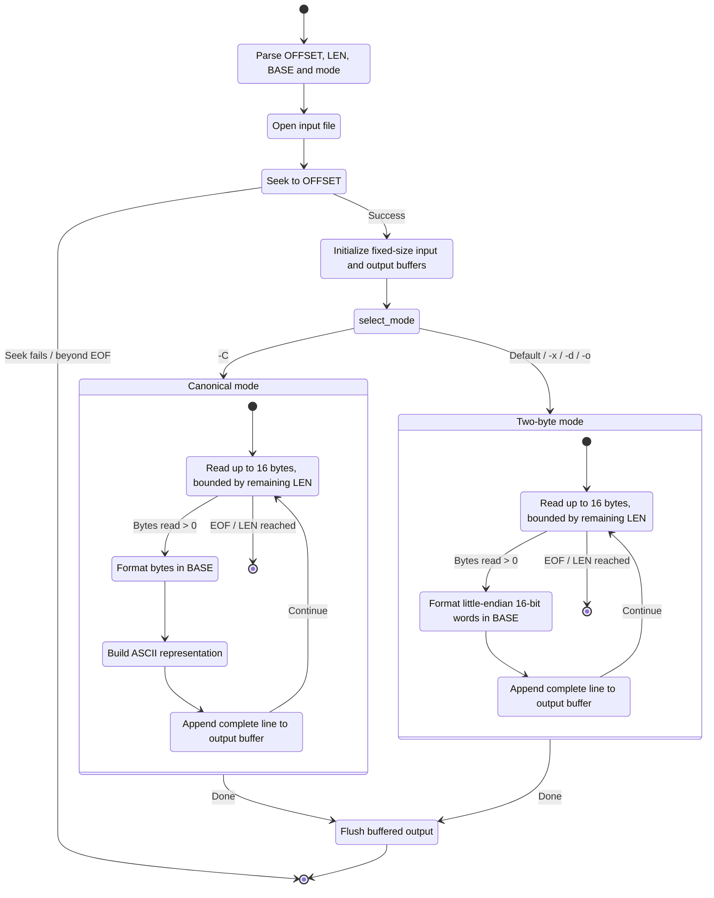

## Hexdumper: a binary file inspector

> This tool was written for learning purposes

### Goal

Read raw bytes and display them

### Scope

Single-file CLI tool. Read-only.

### Features

- `hexdumper [options] FILE`
- Canonical hex+ASCII output (like `hexdump -C`): offset | 16 bytes hex | ASCII.
- Flags: `-n LEN` (byte count), `-s OFFSET` (skip), `-o/-d/-x` (octal/dec/hex 16-bit words).

See 
```shell 
cargo run -- --help
```

### How does it work?


