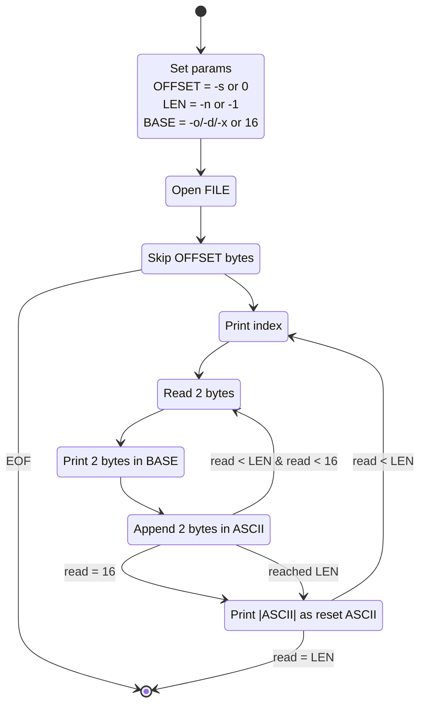

## Hex dump / Binary file inspector

**Goal:** Read raw bytes and display them.

**Scope:** Single-file CLI tool. Read-only.

**Features (must):**

- `hexdump [options] FILE`
- Canonical hex+ASCII output (like `hexdump -C`): offset | 16 bytes hex | ASCII.
- Flags: `-n LEN` (byte count), `-s OFFSET` (skip), `-o/-d/-x` (octal/dec/hex 16-bit words).

- Read from stdin if `-` or no file.

**Stack:** 

- Rust with `std::fs::File` + `Read`

**Deliverable:** Single static binary + README with examples.

**Done criteria:** 

- Can hexdump a 1 GB file with constant memory
- Correct output on at least 5 known files verified against `xxd`

**Stretch:** `--diff` mode comparing two files byte-by-byte.

### How does it work?

